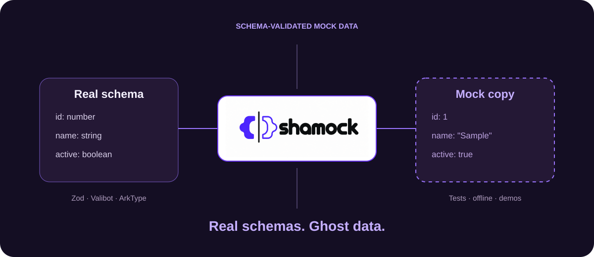

<p align="center">
  <a href="https://techmefr.github.io/shamock/"></a>
</p>

<p align="center">
  <a href="https://github.com/techmefr/shamock/actions/workflows/ci.yml"></a>
  
  <a href="LICENSE"></a>
</p>

<p align="center">
  <a href="https://techmefr.github.io/shamock/"><b>Documentation</b></a> ·
  <a href="https://techmefr.github.io/shamock/getting-started/">Quickstart</a> ·
  <a href="https://techmefr.github.io/shamock/reference/shamock/">API reference</a> ·
  <a href="#ecosystem">Ecosystem</a>
</p>

# shamock

**Real schemas. Ghost data.**

Schema-driven mock / fallback engine. Validate fixtures against any
[Standard Schema](https://standardschema.dev) validator (Zod, Valibot,
ArkType…) so your offline and test data can't drift from the real shape.
Optional MirageJS server for full network interception.

> **Keywords** — `mock` · `mocking` · `fixtures` · `mock-data` · `schema-validation` · `standard-schema` · `typescript` · `zod` · `valibot` · `arktype` · `miragejs` · `offline` · `fallback` · `testing`

## Why shamock

| Feature | What you get |
|---|---|
| **Real schemas** | Validate fixture data with any Standard Schema validator. |
| **Actionable errors** | MockValidationError reports original issues, field paths and list indexes. |
| **Async validation** | Single records and lists support asynchronous validators. |
| **Optional mock server** | MirageJS serves search, mutation and deletion routes from seed data. |

## Install

```bash
pnpm add shamock
# plus the validator of your choice, e.g. zod
# optional, for the in-browser mock server:
pnpm add miragejs
```

## Usage

```ts
import { parseMock, parseMockList } from 'shamock'
import { z } from 'zod'

const product = { schema: z.object({ id: z.number(), name: z.string() }) }

await parseMock(product, { id: 1, name: 'A' })          // → validated single item
await parseMockList(product, [{ id: 1, name: 'A' }])    // → T[] (single object or array)
```

- **`parseMock(resource, mock)`** / **`parseMockList(resource, mock)`** —
  validate `T | T[]` against `resource.schema` (async: Standard Schema's
  `validate` may return a Promise). `resource` only needs a minimal
  `{ schema }` (a `MockableResource`), so there's no dependency on the SDK.
- **`setupMirageMock({ baseUrl, seed, resources?, timing? })`** — spin up a MirageJS server backed
  by `seed` (a `{ [resourceName]: object[] }` map), serving `/:resource/search`,
  `/:resource/mutate` and `DELETE /:resource` in the lomkit REST shape (peer
  dependency `miragejs`, optional). Pass `resources` to validate seeds and `timing` to set response latency.

Standalone fixture validation for tests, or the offline fallback layer for
[`nexdk`](https://www.npmjs.com/package/nexdk).

## Documentation

Full docs, including how to pair `shamock` with `nexdk`, live at
[techmefr.github.io/shamock](https://techmefr.github.io/shamock/).

## Ecosystem

| Project | Role | Documentation |
|---|---|---|
| [neXdk](https://github.com/techmefr/nexdk) | One resource grammar for REST, GraphQL and WebSocket backends. | [Docs](https://techmefr.github.io/nexdk/) |
| [beepr](https://github.com/techmefr/beepr) | Typed events and notification adapters. | [Docs](https://techmefr.github.io/beepr/) |
| [shamock](https://github.com/techmefr/shamock) | Schema-validated mock data, fixtures and offline fallback. | [Docs](https://techmefr.github.io/shamock/) |

Use each library on its own, or compose them in application code. neXdk does not depend on beepr or shamock.

## License

MIT © techmefr
