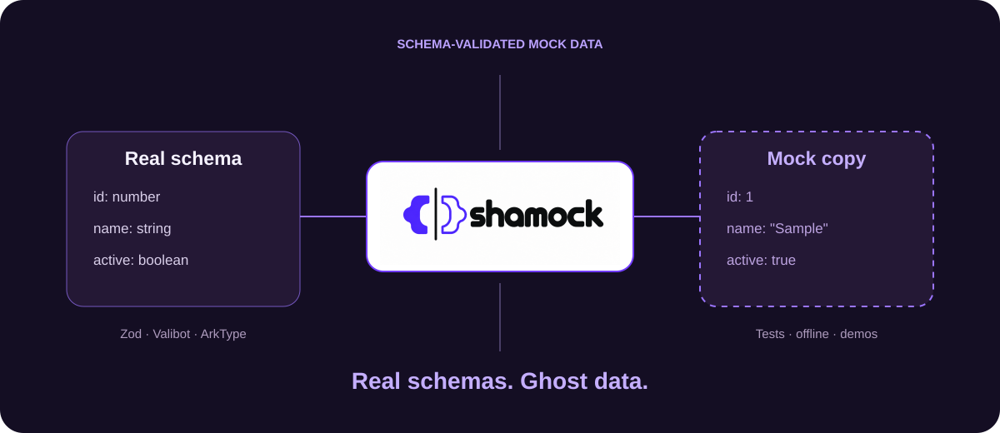

<p align="center">
  <a href="https://techmefr.github.io/shamock/"></a>
</p>

<p align="center">
  <a href="https://github.com/techmefr/shamock/actions/workflows/ci.yml"></a>
  
  <a href="LICENSE"></a>
</p>

<p align="center">
  <a href="https://techmefr.github.io/shamock/"><b>Documentation</b></a> ·
  <a href="https://techmefr.github.io/shamock/getting-started/">Quickstart</a> ·
  <a href="https://techmefr.github.io/shamock/reference/shamock/">API reference</a> ·
  <a href="#ecosystem">Ecosystem</a>
</p>

# shamock

**Real schemas. Ghost data.**

Schema-driven mock engine. Validate fixtures against any
[Standard Schema](https://standardschema.dev) validator (Zod, Valibot,
ArkType...), and serve them from an in-process mock API that answers
`fetch` calls. Zero dependencies.

> **Keywords** — `mock` · `mocking` · `fixtures` · `mock-data` · `schema-validation` · `standard-schema` · `typescript` · `zod` · `valibot` · `arktype` · `offline` · `fallback` · `testing`

## Why shamock

| Feature | What you get |
|---|---|
| **Real schemas** | Validate fixtures with any Standard Schema validator. |
| **Actionable errors** | `MockValidationError` reports issues, field paths and list indexes. |
| **Mock API over `fetch`** | `search`, `mutate` and `DELETE` routes served from seed data. |
| **Safe by default** | Atomic writes, bounded inputs, no dependency. |

## Install

```bash
pnpm add shamock
```

Add the validator of your choice, for example `zod`. Requires Node.js 22 or later.

## Validate fixtures

```ts
import { parseMock, parseMockList } from 'shamock'
import { z } from 'zod'

const product = { schema: z.object({ id: z.number(), name: z.string() }) }

await parseMock(product, { id: 1, name: 'A' })
await parseMockList(product, [{ id: 1, name: 'A' }])
```

## Mock the network

```ts
import { installMock } from 'shamock'

const mock = await installMock({
  baseUrl: 'https://api.example.com',
  seed: { products: [{ id: 1, name: 'A' }] },
  timing: 0,
})

const response = await fetch('https://api.example.com/products/search', {
  method: 'POST',
  body: '{}',
})
const { data } = await response.json()

mock.restore()
```

`installMock` replaces `globalThis.fetch`. Requests under `baseUrl` are
answered from the seed, every other request goes to the previous `fetch`.
`createMock` returns the same mock without touching the global.

## API

| Export | Role |
|---|---|
| `parseMock(resource, mock)` | Validate one value. |
| `parseMockList(resource, mock)` | Validate an array, or wrap one value in an array. |
| `MockValidationError` | Thrown on invalid data, with `issues` and `index`. |
| `createMock(config)` | Returns `{ handle, fetch, install }`. |
| `installMock(config)` | Installs the mock and returns it with `restore()`. |
| `MockConfig`, `MockSeed`, `FetchLike`, `Mock`, `InstalledMock`, `MockableResource` | Types. |

Routes under `baseUrl`: `POST /<resource>/search`, `POST /<resource>/mutate`
and `DELETE /<resource>`. `mutate` supports create and update only. Failures
return `404`, `413` or `422` with `{ message, errors }`. XHR is not intercepted.

### Behavior

- Generated ids are numbers when the seed ids are numbers, strings otherwise.
- With `resources[name]`, created and updated records are validated: `422` with `errors: { field: [messages] }`.
- Updating an unknown id returns `404`. Deleting one succeeds.
- Search accepts `text: { value }` (case-insensitive substring on string values). `like` treats `` as an escape for `%`, `_` and ``. An unknown operator returns `422`.
- `mock.fetch` forwards foreign URLs to the `fetch` captured at `createMock`.

Full details in the [documentation](https://techmefr.github.io/shamock/).

## Ecosystem

| Project | Role |
|---|---|
| [nexdk](https://github.com/techmefr/nexdk) | One resource grammar for REST, GraphQL and WebSocket backends. |
| [beepr](https://github.com/techmefr/beepr) | Typed events and notification adapters. |
| [dialectr](https://github.com/techmefr/dialectr) | One query builder that compiles to lomkit, Strapi and PocketBase. |

Each library works on its own. None is published to npm yet.

## License

MIT © techmefr
